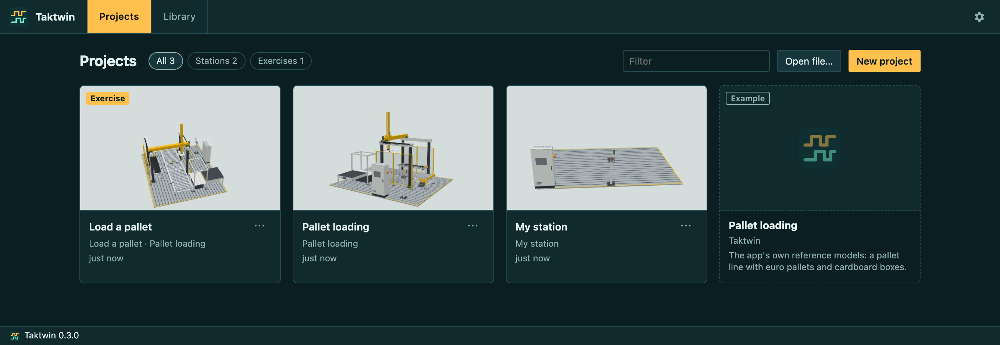

## 👀 Highlights

### 🗂️ Projects

Taktwin now opens on your projects. A project keeps a station's programs, how its PLCs are connected and its settings, and saves itself as it changes. Each card shows the station as you left it and how its last exercise check went. Start a project from a station, an exercise or an empty station, or click the example to begin. **Build** in the top bar puts the project's station together right there.

### 📝 Exercises as one file

**Hand out as exercise…** writes a single `.taktwin-project` with the station, the exercise, its instructions and the collections students need. Students open it with a double-click; Taktwin asks before installing a collection, and offers to continue where they left off.
