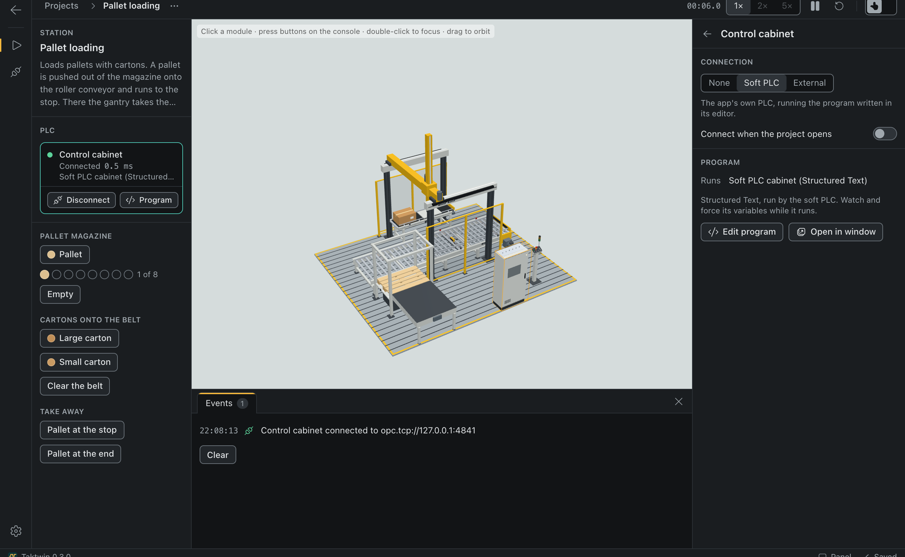

## 👀 Highlights

### 🎨 A new look

Taktwin has a calmer, darker look, and an open project has three views in the bar on the left: **Simulation**, **Wiring** and, in a project on an exercise, **Exercise**. In expert mode a switch in the top bar edits the station and its wiring in place.

### 🔌 Connecting a PLC where it runs

Click a PLC on the left to choose how it connects: none, the soft PLC, or a controller outside the app, such as CODESYS or FluidSIM. The choice takes effect at once, and the PLC's card has the one button that connects it. A PLC keeps a connection of each kind, so trying another loses nothing, and its bindings open in a large dialog over the simulation. Switch on **Connect when the project opens**, and the students' copies of a project connect by themselves.

### 📁 Projects as files

A project is one `.taktwin-project` file that carries everything it needs: its station, programs, connections and the collections it is built from. It saves itself in place as it changes, opens the same on any computer, and can be put back to its original. **Hand out…** gives a copy for students, with or without the programs.

### ⌨️ A program editor for Structured Text

The soft PLC's programs are written in a new editor, with highlighting, completion, problems as you type and formatting, beside the simulation or in a window of its own.

### 🧪 One I/O test for the station

**I/O test** in the top bar cuts the programs of every PLC off at once, and outputs are switched by hand at their lamps. An amber frame round the 3D view shows that it is on.

### 📋 Connections in Events

The panel below the 3D view notes when a PLC connects, cannot connect or loses its connection, with why, each at the time of day.
