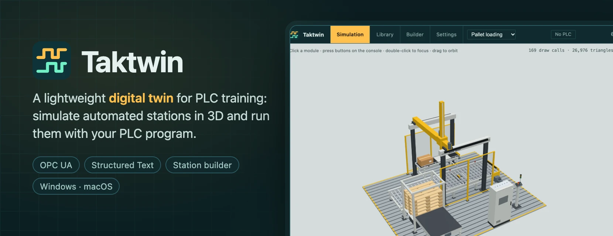

  

# Taktwin

  
  
  
  

Taktwin is a free, open-source digital twin for PLC training. It simulates automated stations in 3D, with their conveyors, magazines, grippers, sensors and wiring, so you can write and test a PLC program without the real machine.

- 🏭 **Stations in 3D:** workpieces move, sensors see them, and cylinders, axes and grippers handle them.
- 🔌 **Your own PLC:** connect CODESYS or any PLC that offers its variables over OPC UA.
- 🧑‍💻 **Built-in soft PLC:** write Structured Text (IEC 61131-3) in the app, with completion, online values, forcing and a watch list.
- 🧱 **Station builder:** put stations together from modules, move them and rewire them, without touching a file.
- ✅ **Exercises:** check a run step by step, the way a grading sheet does.
- 📦 **Open format:** stations are JSON files described by [JSON Schemas](schema), shared as `.taktwin` collections.
- 🪶 **Lightweight:** a native app for Windows and macOS that keeps itself up to date.

## 🚀 Getting Started

Download the latest release for your system:

- **Windows:** [`Taktwin-…-windows-x64-setup.exe`](https://github.com/toblu96/taktwin/releases/latest), installs for your user, without administrator rights.
- **macOS 13+:** [`Taktwin-…-macos-universal.dmg`](https://github.com/toblu96/taktwin/releases/latest), for Apple silicon and Intel.

> [!NOTE]
> Taktwin is not signed yet, so Windows and macOS warn when you first start it. The [release notes](https://github.com/toblu96/taktwin/releases/latest) say how to open it anyway.

Taktwin opens with a pallet loading line. Open the PLC panel, choose **Edit program**, load the example program, **Download** and **Run** it, and press Start on the operator console.

## 📖 Documentation

- [User guide](docs/user-guide.md): stations and collections, the builder, the I/O test, connecting a PLC, the soft PLC and updates.
- [Collection format](catalog/README.md): how stations, modules and workpieces are described, next to the [JSON Schemas](schema).
- [Development](docs/development.md): building the app, running the tests, how the code is organised and how releases are made.

> [!NOTE]
> Taktwin is a personal project, developed for a small circle. Issues and pull requests are not open for now.

## License

[Apache License 2.0](LICENSE).
