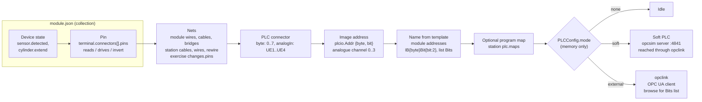
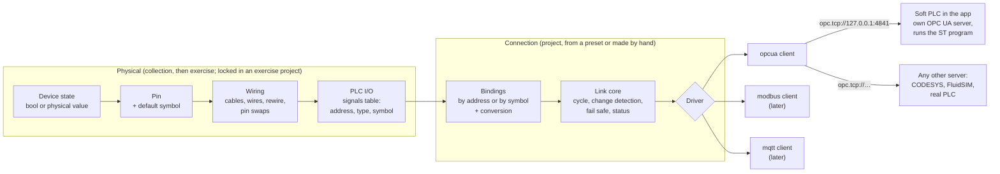
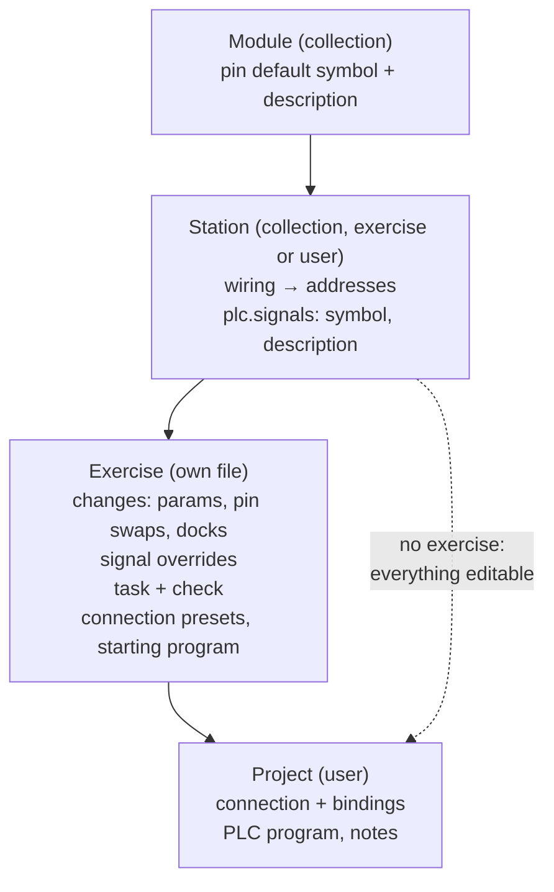

# ADR 0001: Signals, I/O mapping and connection drivers

- **Status:** Accepted
- **Date:** 2026-11-15
- **Scope:** everything between a simulated device and a controller outside the simulation, and the files that carry it: collections, exercises and projects

## Context

Taktwin couples a simulated station to a controller. Today there is one way out: an OPC UA server that offers a CODESYS-style variable list called `Bits`, with variables named by a template such as `IB0Bit00`. The built-in soft PLC takes the same path, through its own small OPC UA server.

Connecting FluidSIM 6 showed where this stops. FluidSIM generates its own OPC UA address space, such as `ns=2;s=Task 2 Template.B1.state_man` (Boolean) and `ns=2;s=Task 2 Template.MB3.state` (Int32). Taktwin connects and then reports *connected, but the server has no "Bits" variables*, because it only accepts variables whose names fit its template and that sit under a node named like the list. No setting changes that, because the station files themselves store the template's names as addresses.

The same will happen with every other server, and with Modbus or MQTT. This ADR decides how signals, addresses, names, connections, exercises and projects are modelled, so that:

- no data model of a reference station, an exercise or one vendor is imposed on what people build
- the PLC module stays independent of the protocol, and protocols are adapters that can be added
- OPC UA works as a plain, generic client for any server
- exercises can be written and handed out week by week, without republishing a collection

## Requirements

| # | Requirement |
|---|---|
| R1 | **Free modelling.** No fixed image size, naming convention, folder structure or vendor layout is required by the model. Reference stations and exercises are examples, not the schema. |
| R2 | **Technology-neutral PLC.** The PLC module describes I/O, not a protocol. Protocols are drivers: OPC UA now, Modbus TCP and MQTT later, without touching stations. |
| R3 | **Generic OPC UA.** The OPC UA driver addresses values the way any OPC UA client does, by NodeId with namespace, or by browse path. No naming rules. |
| R4 | **Layered configuration.** A collection gives defaults, an exercise adjusts the physical station, and a project adds the coupling to the real world. Each layer stores only what it changes. |
| R5 | **Analogue from the start.** Analogue inputs and outputs, such as a height sensor, are part of the model, not an extension. |
| R6 | **Standalone exercises.** An exercise is its own file. It depends on collections but is not part of one. |
| R7 | **Safe by default.** Shared files stay data only. Connecting to the outside world is explicit, does not leak credentials, fails safe, and needs no admin rights. |
| R8 | **Compatible.** Existing collections, stations and exercises keep loading unchanged. |

## Who uses this

| Persona | Goal | Edits | Shares |
|---|---|---|---|
| **Collection author**, such as whoever builds the models of a course's training stations | Build modules and stations other people reuse | Modules (3D, devices, pins), stations, default signal names and descriptions | A collection (`.taktwin`), updated rarely |
| **Exercise author**, usually a teacher | Turn a station into a task, week after week | Starts from installed collections: picks or combines a station, swaps sensors, moves signals to other pins, renames signals, writes the task and its check, optionally adds connection presets and a starting program | An exercise file (`.taktwin-exercise`), sent to the class. A few examples may also ship inside a collection |
| **Learner or tinkerer**, such as an apprentice | Solve an exercise, or play with a station | In an exercise: only the connection to their controller and their program. On a plain station: everything | A project, saved on their own computer, exported to hand in |

## Current state

### Data flow today



### What can be configured at each level, and where

| Level | What is configured | Where | Example from the reference collection | Fixed in code |
|---|---|---|---|---|
| 1. Device | Device types and their states (bool, or a float such as a distance sensor's 0 to 10 V) | `module.json` → `devices` | `photo-sensor`: `sensor` with state `detected` | Device types in `internal/sim` |
| 2. Pin | What each pin of a module's connector reads or drives, `invert`, `constant`, `spare`, `analog`, `function` (description) | `module.json` → `terminal.connectors[].pins`; connector types in `connectors.json` | `photo-sensor`: `W.out` reads `sensor.detected`; `m23-io` = 8 in and 8 out | Pins `I<n>` go to the PLC, `Q<n>` come from it |
| 3a. Wiring inside a module | Which device pin reaches which pin of the module's I/O block | `module.json` → `wires`, `cables`, `terminal.bridges`, contained `modules` | `pallet-conveyor`: `io.T.I0 → start.W.out`, `io.T.Q0 → W.run`; `io-block`: bridge `T ↔ X1` | |
| 3b. Wiring in a station | Which module socket goes to which PLC socket; moving a signal to another pin of a terminal | `station.json` → `cables`, `wires`, `modules[].rewire`, `modules[].parts`; builder: Plug, MovePin | `conveyor.X1 → cabinet.X1` | |
| 3c. Wiring in an exercise | Pins swapped on a terminal; signal names follow their devices | `exercise.json` → `changes.pins`, inside a collection's `exercises/<id>/` | (none in the reference exercise) | Exercises exist only inside collections |
| 4. PLC I/O | Which PLC connector is which image byte, analogue inputs | PLC module `module.json` → `role: plc`, device `plc`, connectors with `byte` / `analogIn` | `control-cabinet`: `X1` = byte 0 … `X6` = byte 5 | 8 bytes in, 8 out (`plcio.ImageBytes`); 4 analogue inputs in volts; no analogue outputs, no words |
| 5. Variable names | Template for the names of inputs, outputs and analogue inputs, and the list they are in | PLC module → `addresses` | `IB{byte}Bit{bit:2}`, `QB{byte}Bit{bit:2}`, `AI{channel}`, `Bits` | Used as the station's addresses, in `Bits.st`, for OPC UA discovery, and to check maps |
| 6. Symbols | Name, variable and description per address | `station.json` → `plc.signals`, `plcs[]`; builder: SetSignal | `{ address: IB0Bit00, name: B1, variable: palletIn }` | A bit without a name gets `instance.pin`. Exercise checks use these names (`in.B1`, `out.M1`) |
| 7. Program maps | A program written for another wiring: signal → variable, invert | `station.json` → `plc.maps`; chosen in the PLC panel | (none in the reference station) | The variable must fit the template of level 5 |
| 8. Controller choice | none / soft / external, endpoint, map | `PLCConfig` in memory (`internal/simapp/service.go`); endpoint in the browser's `localStorage` | `opc.tcp://127.0.0.1:4840` | Not saved with anything; gone when the station reloads |
| 9. Soft PLC program | Structured Text sources, task | `<user folder>/programs/<station>/<plc>/` (`Bits.st` generated, `project.json`); example in a collection's `programs/<station>/<plc>/` | `programs/pallet-loading/cabinet` | |
| 10. Transport | OPC UA client and server | `internal/opclink`, `internal/opcsim` | | Security None and anonymous only; browse at most 5000 nodes, 10 deep; polling every 10 ms; outputs off when the link is lost; the soft PLC listens on port 4841 |

In the reference collection, the I/O block on a module (role `terminal`) is what the field calls a mini-IO or I/O terminal. The PLC connectors are where its byte enters the image.

### Problems

| # | Problem | Effect |
|---|---|---|
| P1 | One string, such as `IB0Bit00`, is three things at once: a position in the image, its display format, and the identifier on the protocol | Changing the outside world changes station files |
| P2 | The direction of a variable is read from its name (`naming.Parse`) | A server that names things its own way cannot be used |
| P3 | The image is fixed: 8 + 8 bytes of bits and 4 analogue inputs | Larger stations, analogue outputs and setpoints cannot be modelled |
| P4 | The OPC UA client assumes CODESYS: a list node, browse names, security None, anonymous. It ignores namespaces | FluidSIM and most other servers fail |
| P5 | The connection is not saved anywhere and cannot be shared | Teachers cannot prepare one; learners set it up again after every reload |
| P6 | Maps can only use names that fit the template | They cannot bridge to a different naming |
| P7 | There is no project: a learner's work is spread over `programs/<station>/<plc>`, `localStorage` and memory | Nothing to save, hand in or move to another computer |
| P8 | Default symbol names exist only in station files | A module author cannot ship a module with its own default names |
| P9 | Exercises live inside collections | A new weekly exercise means a new collection release |

## Decision

### 1. Four concepts, one job each

| Concept | Is | Owned by | Example |
|---|---|---|---|
| **Signal** | One I/O point of a PLC as the station sees it: direction (input or output, from the PLC's view), type, address, symbol, description | Created by the wiring | The sensor at the start of the conveyor |
| **Address** | Where the signal is in the PLC's process image. Stored in the canonical IEC 61131-3 form; how it is *shown* is up to the PLC module | Derived from the wiring (PLC connector + pin) | `%IX0.3`, shown as `I0.3`, `E0.3` or `IB0Bit03` |
| **Symbol** | The name people, programs and exercise checks use | Module default, overridden by station and exercise | `B1`, `M1`, `palletIn` |
| **Binding** | Which item of the outside world a signal is exchanged with, and how it is converted | A connection | `B1 ↔ nsu=…;s=Task 2 Template.B1.state_man` |

Rule: **physical things belong to modules, stations and exercises; the coupling to the outside belongs to connections.** A connection never changes the station, and a station never knows a protocol.

### 2. Data flow, proposed



The simulation is always a client. The soft PLC is a separate OPC UA server inside the app, reached exactly like an external one (see section 8).

### 3. The PLC module is technology-neutral

A PLC module describes its process image and how addresses are shown. It names no protocol, list or variable.

```json
"role": "plc",
"plc": {
  "image": { "inputBytes": 16, "outputBytes": 16 },
  "addressFormat": { "input": "IB{byte}Bit{bit:2}", "output": "QB{byte}Bit{bit:2}", "inputWord": "IW{byte}", "outputWord": "QW{byte}" },
  "analog": {
    "inputs":  [ { "connector": "UE1", "address": "%IW8",  "type": "INT", "range": [0, 10], "unit": "V", "raw": [0, 27648] } ],
    "outputs": [ { "connector": "UA1", "address": "%QW8",  "type": "INT", "range": [0, 10], "unit": "V", "raw": [0, 27648] } ]
  }
}
```

- `addressFormat` is display only (see the open question on address display). Everything is stored as `%IX0.3`, `%IW8`.
- The image size is per module, not a constant in code. Digital bytes and analogue words share one image, as on a real PLC. A module that places analogue words outside its declared size is an error at load time.
- Connectors keep `byte` and `analogIn`; `analogOut` is added the same way.

### 4. Data types: how much freedom

Signals have one of these types:

| Type | For |
|---|---|
| `BOOL` | Sensors, valves, lamps, buttons: almost everything |
| `INT` (16-bit) | Analogue values in the usual PLC representation, such as 0..27648 for 0..10 V |
| `DINT` (32-bit) | Counters, positions in increments |
| `REAL` (32-bit float) | Analogue values in physical units, setpoints |

- **Analogue is in scope from the first step**, in both directions. An analogue height sensor is an analogue input; a speed setpoint for a frequency converter or a proportional valve is an analogue output.
- Inside the simulation an analogue value is a physical value (float64 with a unit, such as 7.3 V or 12.4 mm). The PLC module says how a channel appears in the image (`INT` raw, or `REAL`). The conversion between the two happens in one place, the PLC module's `range` and `raw`.
- A binding may convert again for its outside item, with a linear `scale`, for a server that wants millimetres or percent.
- Bytes and words of packed bits are **views**, not signal types. A binding can target one bit of an integer item (`bit: 3`) for servers that only offer bytes.
- Strings, arrays and structures are out of scope. Something richer is modelled as several signals. Drivers can still bind one signal to one array element (OPC UA index range).

This covers digital I/O, analogue sensors and actuators, positioning setpoints and counters, which is what training stations have. It stays simple enough to show in the I/O test and to declare in ST with `AT %IX0.3`, `AT %IW8`.

### 5. Layers and overrides



| Layer | File | May set | Note |
|---|---|---|---|
| Module | `module.json` in a collection | A default `symbol` per pin (new) and its `function` | A pin knows its place on its own connector (I0 of X1), not its PLC address. That depends on where the station cables it |
| Station | `station.json` in a collection, an exercise, or the user folder | Wiring, so addresses; `plc.signals` per address: symbol, description | As today |
| Exercise | `exercise.json` in an exercise file | `changes` (as today), signal overrides, task and check, connection presets, starting program | "Conveyor start on bit 3 instead of 0" is a pin swap here, a physical change |
| Project | `project.json` in the user folder | One connection per PLC, the program, notes. On a plain station also its own `changes` and signal overrides | Stores only differences to its base |

- **Overlays, not copies.** Every layer is a patch keyed by stable ids: instance ids, terminal pins, addresses. Nothing is copied from the layer below.
- **Later wins, per key.** A symbol set by the exercise beats the station's, which beats the module's default.
- **An exercise locks the physical part.** In a project based on an exercise, wiring, `changes` and symbols are read-only. The check refers to symbols (`in.B1`, `out.M1`) and to the physical setup, so changing them would break it. The learner adapts to their real world through the connection's bindings, which is what a technician does too: the machine is given, the mapping to the controller is theirs.
- **Projects follow updates.** A project references its base by id, not by a copy. When the exercise or collection is updated, the project opens on the new version. Its overlay is applied again; bindings to signals that no longer exist are reported, not dropped silently. The project records the version it was last opened with, so the update is shown to the learner.

### 6. Exercises are standalone files

An exercise and a project both describe "this station, set up like this, with this coupling". So they share **one overlay format**. What differs is who owns them and what else they carry.

| | Exercise | Project |
|---|---|---|
| Is | A read-only template with a task and a check | A learner's working copy |
| Distributed as | A `.taktwin-exercise` file (zip), sent by the teacher; examples may also sit in a collection's `exercises/` | A `.taktwin-project` file (zip), to hand in or move |
| Installed into | `<user folder>/exercises/<id>/` | `<user folder>/projects/<name>/` |
| Depends on | Collections, by id and minimum version | One exercise, or one station |
| Extra content | Task, check, connection presets, starting program, its own station if needed | The connection in use, the learner's program, notes |
| Contains credentials | Never | Never; references a stored secret |

So an exercise does **not** belong to a collection. The models of the training stations are installed once, as a collection. Each week the teacher writes an exercise that uses them, exports it, and sends the file to the class. The learner opens it, which installs it and creates a project. The collection is not touched.

Exercise file:

```
sorting-03.taktwin-exercise   (zip, data only)
  exercise.json        id, version, name, requires, station, changes, signal overrides, rules, steps
  station.json         optional: a station built for this exercise from the collections' modules
  connections/*.json   optional: connection presets, such as "FluidSIM" or "CODESYS"
  programs/<plc>/      optional: a starting program in Structured Text
  docs/                optional: task text and images
```

```json
{
  "format": 2,
  "id": "ch.swissskills.sorting-03",
  "version": "1.1.0",
  "name": "Sorting by colour",
  "requires": { "training-stations": "^1.2.0" },
  "station": "sorting",
  "changes": { "pins": [ { "instance": "conveyor", "pin": "T.I0", "with": "T.I3" } ] },
  "signals": { "%IX0.3": { "symbol": "B_Start", "description": "Workpiece at the start of the conveyor" } },
  "rules": [ ],
  "steps": [ ]
}
```

- **Ids are free text.** The author chooses them. The app's default for a new exercise, and the documentation's examples, use a reverse-domain prefix such as `ch.swissskills.` so that ids from different schools rarely collide. It is a convention, not a rule.
- **Collections and exercises use [Semantic Versioning](https://semver.org/).** Collections already carry a semver `version` (`"0.1.0"`). A collection author raises the major version when a change can break exercises built on it: a module, instance, pin or signal removed or renamed.
- **`requires` holds semver ranges**, one per collection id, in the usual npm syntax: `^1.2.0` means 1.2.0 or later, below 2.0.0. If a required collection is missing, or its installed version is outside the range, opening the exercise is refused with a message that names the collection, the range and the installed version. Nothing half-loads.
- **The same check runs when a collection is installed or updated.** If the new version falls outside the range of an installed exercise, the import names those exercises, so the teacher sees the break before the students do.
- An exercise may bring its own `station.json`, built from modules of the required collections. New modules (3D models, devices) belong in a collection: they are reused, large and reviewed differently from a weekly task.
- Installing an exercise with the same id and a higher version replaces the old one, and projects based on it follow (see section 5). A lower version is refused with a message.
- Old exercises inside collections keep loading. They are examples with the collection as their implicit `requires`.

Project:

```
<user folder>/projects/<name>/
  project.json        base (exercise or station), last opened version, overlay, connections
  programs/<plc>/     Structured Text sources (today in programs/<station>/<plc>/)
```

```json
{
  "format": 1,
  "base": { "exercise": "ch.swissskills.sorting-03", "opened": "1.1.0" },
  "connections": {
    "cabinet": { "preset": "fluidsim", "values": { "project": "Sortieren Lernender 07" } }
  }
}
```

"Turn a project into an exercise" is an export: its overlay, plus a task and a check, becomes an exercise file. Keeping the word *exercise* is still worth it, because it marks the read-only, gradable part.

### 7. Connections and bindings

**One connection per PLC.** A station with two PLCs has two connections. A connection is either a preset from an exercise, which the project uses with its own values, or one the learner makes.

```json
{
  "id": "fluidsim",
  "name": "FluidSIM",
  "plc": "cabinet",
  "driver": "opcua",
  "vars": {
    "type": "object",
    "required": ["host", "project"],
    "properties": {
      "host":    { "type": "string", "title": "Computer running FluidSIM", "default": "127.0.0.1", "minLength": 1 },
      "project": { "type": "string", "title": "FluidSIM project name", "default": "Task 2 Template", "minLength": 1 }
    }
  },
  "settings": {
    "endpoint": "opc.tcp://{host}:62555",
    "security": { "policy": "None", "mode": "None" },
    "auth": { "type": "anonymous" },
    "outputs": { "exchange": "subscribe", "interval": 10 }
  },
  "namespaces": { "fs": "<namespace URI that FluidSIM reports for ns=2>" },
  "bindings": [
    { "signal": "B1",  "item": { "nodeId": "nsu={fs};s={project}.B1.state_man" } },
    { "signal": "B2",  "item": { "nodeId": "nsu={fs};s={project}.B2.state_man" } },
    { "signal": "MB3", "item": { "nodeId": "nsu={fs};s={project}.MB3.state" } }
  ]
}
```

- **Direction comes from the signal.** For an input, Taktwin writes to the item; for an output, it reads it. Nothing is inferred from external names.
- **Unbound signals** are not exchanged, and the status report lists them.
- **Conversion per binding:** `invert`; type coercion (BOOL ↔ integer as ≠ 0, to the item's own DataType); linear `scale` for analogue values; `bit` for one bit of an integer item.
- **`generate` is a shortcut.** It expands a template into explicit bindings before connecting, with `{byte}`, `{bit}`, `{address}`, `{symbol}` and the connection's vars. Explicit bindings win over generated ones. A template never restricts what can be bound.

```json
"generate": [
  { "signals": "inputs",  "item": { "nodeId": "nsu={app};s={prefix}.IB{byte}Bit{bit:2}" } },
  { "signals": "outputs", "item": { "nodeId": "nsu={app};s={prefix}.QB{byte}Bit{bit:2}" } }
]
```

#### Vars are described with JSON Schema; the form is generated

Every value someone may need to change is a **var**. `vars` is a [JSON Schema](https://json-schema.org/) (draft 2020-12) of `"type": "object"`, with one property per var. The app renders the connection form from it and validates the values against it. There is no driver-specific or exercise-specific UI code.

The form renderer supports this subset of the standard:

| JSON Schema keyword | In the form |
|---|---|
| `type`: `string`, `integer`, `number`, `boolean` | Text field, number field, switch |
| `title`, `description`, `examples` | Label, help text, placeholder |
| `default`; `required` on the object | Value when the project sets none; field must be filled |
| `minimum`, `maximum`, `exclusiveMinimum`, `exclusiveMaximum`, `multipleOf` | Limits and step of a number field |
| `minLength`, `maxLength`, `pattern`, `format` (`uri`, `hostname`, `ipv4`) | Checks on a text field |
| `enum`, or `oneOf` of `{ "const": …, "title": … }` | Drop-down, with labels for the `oneOf` form |
| `readOnly` | Shown, not editable |
| `writeOnly` | A secret: entered, never shown again, stored in the OS keychain and not in any file |

- Schemas may use any other keyword of the standard; it is still validated, and the field is shown as a plain text or number field. Units go into the `title` ("Interval (ms)"), so no keyword outside the standard is needed.
- Validation uses a standard validator (in Go, for example `santhosh-tekuri/jsonschema`, which implements draft 2020-12), so the files can also be checked in an editor or CI with any JSON Schema tool.
- The same format describes each driver's own `settings`: `Driver.Schema()` returns a JSON Schema. The `opcua` driver's declares the endpoint (`format: uri`, `pattern: ^opc\.tcp://`), security policy and mode (`oneOf`), authentication, user name, password (`writeOnly`), output exchange (`poll` or `subscribe`) and interval (`integer`, 5..1000). The form for a connection is the driver's settings plus the preset's vars.
- The preset declares the vars and their defaults; the project stores only `values`. Values are validated before use.
- `{name}` is replaced as plain text, only in fields the driver marks as templated (endpoint, items). There are no expressions. An unknown var is an error.

#### The binding key: by address or by symbol

The binding key is what a binding uses to find its signal in the station. There are two choices, and they behave differently when an exercise moves a signal to another pin.

Example: the exercise swaps the conveyor's *run* output from `Q0` to `Q3` on its I/O block. The signal `M1` now sits at `%QX0.3` instead of `%QX0.0`.

| Key | Binding | After the swap | Use it for |
|---|---|---|---|
| **Address** `"address": "%QX0.3"` | Bound to a position in the image | The outside sees *run* at the new address, as a real PLC would after rewiring. The learner's program has to follow the wiring | Real PLCs, the soft PLC, CODESYS variables that stand for image addresses: anything that emulates I/O wiring |
| **Symbol** `"signal": "M1"` | Bound to the meaning | The outside does not notice the swap; `M1` is still `M1` | Co-simulation at component level (FluidSIM's `B1`, `MB3`), symbolic PLC variables |

Both are needed, so every binding states which one it uses. The binding editor shows address and symbol side by side. A symbol that is unknown or used twice is an error when the connection is resolved, not a silent mismatch.

### 8. Driver architecture

```go
// internal/link: protocol-neutral, implements plcio.Controller for one PLC.
type Driver interface {
    Kind() string                                 // "opcua", "modbus", "mqtt"
    Schema() DriverSchema                         // JSON Schemas of its settings and items
    Validate(cfg Config) error                    // static checks, no network
    Open(ctx context.Context, cfg Config, b []Binding, env Env) (Session, error)
}

type Session interface {
    // Resolve checks every binding once: exists, type, readable or writable.
    Resolve(ctx context.Context) (Report, error)
    // Run exchanges values until ctx ends or the link fails. A polling driver loops
    // on io.Inputs() and io.SetOutputs(); a push driver (MQTT, OPC UA subscriptions)
    // reacts to io.Changed() and to incoming data.
    Run(ctx context.Context, io Exchange) error
    Close() error
}

type Binding struct {
    Signal  SignalRef        // resolved signal: address, type, direction
    Convert Conversion       // invert, type, scale, bit
    Item    json.RawMessage  // driver-specific; the core never reads it
}
```

| Part | Does |
|---|---|
| **Core** (`internal/link`) | Fills in vars, expands `generate`, resolves bindings against the signals table, keeps the latest values, runs the session, reconnects, turns outputs off on loss, measures round trip, reports status per binding. `Scan` never waits for the network (as today) |
| **Driver** | Only the protocol: connecting, resolving items, reading and writing, converting to the protocol's types |
| **Registry** | Drivers are compiled in and register themselves. An unknown `driver` in a file is refused with a clear error |

| Driver | Item | Note |
|---|---|---|
| `opcua` | `nodeId` or `path` | Client for any server, including the soft PLC |
| `modbus` (later) | `{ unit, table: coil\|discrete\|holding\|input, address, bit? }` | Client |
| `mqtt` (later) | `{ topic, codec: raw\|json, path? }` | Client |

The simulation acting as a server (an outside PLC connecting to it) is not planned. The interface does not prevent it, but nothing in this ADR depends on it.

#### The soft PLC is an OPC UA server, reached through the normal client

As today, the soft PLC runs its Structured Text program behind its own OPC UA server inside the app (`internal/opcsim`), one per PLC of the station, on `127.0.0.1` from port 4841 up. The simulation connects to it with the same `opcua` driver as to any external server. So:

- the path a learner uses with CODESYS or FluidSIM is the one the soft PLC exercises every day
- the soft PLC can be watched and written with UaExpert, like a real PLC
- there is no second exchange path to maintain

What changes is its address space and how the connection is made:

- **Address space.** The server is ours, so it uses the canonical addresses instead of the CODESYS-style template: one node per signal, `nsu=urn:taktwin:softplc;s=<plc>.%IX0.3`, with the display address and symbol as DisplayName (`IB0Bit03 B_Start`) and the description as Description. Analogue words are `Int16` or `Float` nodes, like `%IW8`. Its namespace URI is fixed, so its NodeIds do not depend on the index.
- **Connection.** Choosing "Soft PLC" in the PLC panel uses a built-in preset of the `opcua` driver. The app fills in the endpoint of the running server (a `readOnly` var), and the preset binds every signal by address with `generate`. Nothing has to be set up.
- **Program.** It declares its signals with `AT %IX0.3`, `AT %IW8`; the generated declarations use the symbols.

### 9. OPC UA: a plain, generic client

How a client normally reaches a value, and what Taktwin does:

1. **Endpoint.** The URL is `opc.tcp://host:port[/path]`. The client asks the server for its endpoints (GetEndpoints) and chooses one by security policy and message security mode (None, Sign, SignAndEncrypt). It then authenticates as anonymous, with user name and password, or with an X.509 certificate.
   - Taktwin supports all of these, not only None and anonymous.
2. **Node address.** The address of a node is its NodeId: `ns=<index>;i=<number>`, `s=<string>`, `g=<guid>` or `b=<bytes>`.
   - The namespace index is only a position in the server's namespace table (`Server.NamespaceArray`, `i=2255`), and the server may change it.
   - The stable form is the ExpandedNodeId with the namespace URI: `nsu=<uri>;s=…`.
   - On every connection, Taktwin reads the namespace table and resolves URIs to indexes. A NodeId typed with `ns=` is accepted. When one is picked in the browser, it is saved with its URI.
3. **Browse path, as an alternative.** For servers whose NodeIds are not stable, an item can be a path from a start node: a RelativePath such as `/2:Projects/2:Task 2 Template/2:B1/2:state`. It is resolved once per session with TranslateBrowsePathsToNodeIds.
4. **Resolve.** For every bound node, Taktwin reads `DataType`, `ValueRank` and `AccessLevel`/`UserAccessLevel` (CurrentRead, CurrentWrite) once per session. Then it reports per binding:
   - not found (`BadNodeIdUnknown`)
   - not writable, for an input
   - a type it cannot convert
5. **Exchange.**
   - A Write must carry a value of the node's own DataType, or the server may refuse it with `BadTypeMismatch`. Taktwin converts to the resolved type.
   - Inputs are written when they change.
   - Outputs are read by polling or by a subscription with monitored items, as the connection's settings say.
6. **Browsing in the UI.** A lazy tree from `Objects`, showing NodeId, DataType and AccessLevel, as in UaExpert. Picking a node creates a binding. There is no list node, folder convention or depth limit.
7. **No naming convention.** The current search for a `Bits` list with template names is removed. A CODESYS user binds variables from the CODESYS symbol configuration like any other node. For the common case of one GVL with one variable per image bit, a preset with `generate` and two vars (namespace URI and the GVL's NodeId prefix) does it in one step.

What FluidSIM 6.3 shows (from UaExpert):

- Nodes are `ns=2;s=<FluidSIM project>.<designation>.<variable>`, such as `….B1.state` (Int32), `….B1.state_man` (Boolean) and `….MB3.state` (Int32).
- Only `state_man` can be written, so inputs (sensors simulated by Taktwin) bind to `<designation>.state_man`, and outputs (valve coils driven by FluidSIM) are read from `<designation>.state`.
- NodeIds stay the same across restarts, so NodeId items are enough. The project name inside them is a var.
- The namespace URI behind `ns=2` is known (Server › NamespaceArray). It names the vendor, so it lives in the presets of the collection that ships them, not in this repository. Presets store NodeIds with this URI (`nsu=…`) rather than `ns=2`, so they keep working if a FluidSIM version or setup ever puts the namespace at another index.

### 10. Safety

| Risk | Measure |
|---|---|
| Code in shared files | Drivers are compiled into the app. Collections, exercises and projects remain JSON and ST only; no scripts or plugins. Vars are plain text substitution, without expressions |
| Exercise files from mail or a USB stick | Treated like collections: unpacked as data, paths checked against the zip slip, size limited. Installing shows the name, version, the collections it requires and its connection presets |
| A file connects somewhere unexpected | A connection from an exercise or an imported project is a preset. It is never opened automatically. The user opens it and sees its endpoint. The first connection to a host other than this computer asks for confirmation |
| Credentials leaking through shared files | Files hold no passwords or private keys. `secret` vars go to the user's own OS keychain (macOS login keychain, Windows Credential Manager, Secret Service on Linux), which needs no admin rights. Where none is available, a file only the user can read. Logs never contain secrets |
| Unencrypted or impersonated servers | The app keeps its own instance certificate in the user's config folder. A server certificate is trusted on first use, with its fingerprint shown, and kept in a per-user trust list. Secure policies are preferred when offered. None is allowed but flagged |
| Writing to what should not be written | Taktwin writes only to items bound to input signals, after Resolve has confirmed they are writable. A **monitor only** option reads without writing |
| A real machine behind a real PLC | Writing simulated sensor values into a PLC that drives real equipment can move it. Connections to other hosts show this warning, and documentation recommends a PLC without real outputs (simulation mode) |
| Opening ports, admin rights | The only listening sockets are the soft PLC servers, bound to `127.0.0.1` on ports above 1024, with security None and anonymous access as today. Nothing on the network can reach them, and they need no admin rights. Everything the app writes is under the user folder |
| Hangs and floods | Every call has a timeout; browsing is paged and cancellable; the number of bindings per connection is limited; endpoints are checked against each driver's URL schemes. A driver runs in its own goroutine with panic recovery: a crash fails the link instead of the app |
| Lost link | Outputs go to off, as on a real fieldbus (as today). A watchdog marks the link failed when the exchange stops |

### 11. Migration and compatibility

| Today | Becomes | Old files |
|---|---|---|
| PLC module `addresses` | `plc.addressFormat`, display only | Read as before |
| `plc.signals[].address` such as `IB0Bit00` | Canonical `%IX0.0`, parsed with the module's old template | Read as before; written in the new form |
| `plc.maps` | Bindings of a connection, with `invert` | Offered as presets |
| Exercises in a collection's `exercises/` | Standalone `.taktwin-exercise` files; the old place still works for examples | Read as before |
| `PLCConfig` in memory, endpoint in `localStorage` | One connection per PLC in the project | |
| Soft PLC behind `internal/opcsim` with `Bits.IB0Bit00` nodes, mode `soft` | Same server, nodes by canonical address in its own namespace; reached through the "Soft PLC" preset of the `opcua` driver | |
| OPC UA discovery of the `Bits` list | Removed; a CODESYS preset with `generate` | Users with a CODESYS project choose the preset once |
| Exercise ids and integer versions | Free-text ids, semver versions, `requires` with semver ranges | An exercise without `requires` inside a collection requires that collection |
| `programs/<station>/<plc>/`, generated `Bits.st` | `projects/<name>/programs/<plc>/`; the generated list declares symbols `AT %IX…`, `AT %IW…` | Old folders imported once |
| `plcio.Image` fixed at 8 bytes, 4 analogue inputs | Image sized by the PLC module, with analogue words in and out | |

## Consequences

**Benefits**

- Any OPC UA server works, including FluidSIM's generated tree, without renaming anything in FluidSIM or in station files.
- New protocols are a driver, not a change to the model.
- Teachers write and hand out exercises week by week; the collection stays as installed.
- Learners can save, hand in and move their work, and their connection is part of it.
- Connection forms come from JSON Schema, so a new driver or preset needs no UI code, and files can be checked with standard tools.
- Module authors can ship default symbol names.
- The soft PLC uses the same client path as an external PLC and stays observable with UaExpert.
- A collection update that breaks an installed exercise is reported at import, not in class.

**Costs**

- New concepts (connection, binding, project, exercise file) and a binding editor in the UI.
- A migration path for addresses, maps, exercises and soft PLC folders, with tests.
- The image grows from a fixed array to a sized, typed one, with analogue outputs. This touches the simulation, the I/O test, the soft PLC, the ST compiler (`%IW`, `%QW`) and the exercise checks.
- Collection authors have to follow semver for the check to mean anything.

## Alternatives considered

| Alternative | Why not |
|---|---|
| Keep naming templates and make them configurable per connection | Still a convention. FluidSIM's two nodes per component (`state`, `state_man`) and its project name inside the NodeId would still not fit |
| Keep the `Bits` list search as one item type | It only serves CODESYS with one layout, and keeps a second way of resolving nodes alive. A `generate` preset gives the same result with plain NodeIds |
| Bind to device or pin references (`conveyor.start.W.out`) | Too internal: they change when a module is reworked. Symbols and addresses are the public face of a station |
| Load drivers at runtime (Go plugins, WASM, scripts) | Breaks the promise that shared files cannot run code, and is hard to support on every platform. A compiled-in registry is enough for a handful of protocols |
| Projects as copies of station files | Updates of a collection or exercise would never reach them. An overlay keeps the link |
| Exercises only inside collections | Every weekly exercise would need a new collection release, sent to every learner |
| Drop exercises and only have projects | Loses the locked, gradable part. Sharing one overlay format gives most of the simplicity anyway |
| Run the soft PLC in memory, as an `internal` driver | A second exchange path next to OPC UA. The soft PLC would no longer test the path learners use with real controllers, and could not be watched with UaExpert |
| Hand-written connection forms per driver | Every driver and preset would need UI work, and limits would be checked in two places |
| An own schema format for vars (`label`, `min`, `secret`) | Needs its own documentation and validator. JSON Schema is known, has validators and editor support, and covers everything with `title`, `minimum`, `writeOnly` |
| Exercise versions as integers, `requires` as a minimum version | Cannot express that a new major version of a collection breaks an exercise |

## Decided in review

| Question | Decision |
|---|---|
| May a learner change wiring and symbols in an exercise project? | No. The physical part is locked, otherwise the exercise and its check break |
| Does a project follow updates of its exercise? | Yes, by id; changes are reported |
| Connections per PLC | One |
| Taktwin as a server | Not needed. The simulation is an OPC UA client to FluidSIM, CODESYS or the soft PLC |
| Soft PLC | Keeps its own OPC UA server, reached through the normal `opcua` driver, observable with UaExpert |
| Analogue | Inputs and outputs from the start |
| Secrets | OS keychain, at user level, without admin rights |
| FluidSIM | Only `state_man` is writable; this is part of the bindings. NodeIds are stable. The namespace URI is known and goes into the presets |
| Exercises in collections | No: standalone files; collections may hold examples |
| Vars | JSON Schema, draft 2020-12 |
| Address display | Decided by the PLC module only |
| Exercise ids | Free text; defaults and examples suggest a `ch.swissskills.` style prefix |
| Versions | Semver for collections and exercises; `requires` holds semver ranges; a mismatch is an error at import and at opening |

## Open questions

None at the moment.

## References

- [OPC 10000-6, 5.1.12: QualifiedName, NodeId and ExpandedNodeId string encoding](https://reference.opcfoundation.org/specs/OPC-10000-6/5.1.12)
- [OPC 10000-3, 8.2: NodeId](https://reference.opcfoundation.org/Core/Part3/v105/docs/8.2)
- [OPC 10000-4, 5.9.4: TranslateBrowsePathsToNodeIds](https://reference.opcfoundation.org/specs/OPC-10000-4/5.9.4)
- [OPC 10000-4, Annex A: RelativePath text format](https://reference.opcfoundation.org/Core/Part4/v104/docs/Annex%20A)
- [OPC Labs: namespace indices in OPC UA NodeIds](https://opclabs.com/files/onlinedocs/OPCLabs-OpcStudio/Latest/User%27s%20Guide%20and%20Reference-OPC%20Studio/Namespace%20indices%20in%20OPC%20UA%20Node%20Ids.html)
- [FluidSIM 6 version history](https://www.art-systems.de/www/site/en/downloads/history-fs6.html)
- [`st/README.md`](../../st/README.md): direct addresses `AT %IXn.m` and `%QXn.m`
- [`catalog/README.md`](../../catalog/README.md): the file formats this ADR builds on
